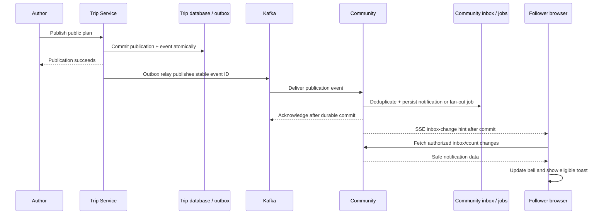

# Navio profiles, social connections, and live notifications

**Status:** Planning only. No application implementation is authorized by this document.
**Prepared:** 2026-10-31.
**Requested outcome:** A complete, colorful profile experience with private settings, public profiles, following, privacy and safety controls, and persistent Kafka-backed notifications that appear throughout the app, including the planner.

**Implementation status (2026-10-31, Claude):** Phases 2-6 are live (root main 6d5e7e4). Phases 7 (trip outbox -> Kafka -> Community consumer, quarantine and replay) and 8 (authenticated SSE, app-wide provider, toasts) are implemented and verified locally on `feat/live-notifications` branches (worktrees in `Capstone/Navio-worktrees/live-notifications/`), not pushed or released. Phase 9 is not started. Details, evidence and limits: `docs/agents/handoff.md` (top entry) and `docs/features/live-notifications.md` on that branch.

This document is the implementation brief and acceptance checklist. An unchecked task is future work, not evidence that a capability exists. Implementation starts only after the user asks to proceed. Completing this plan does not authorize deploying it.

## 1. Required working rules

- Continue the existing profile-management work: the observed client branch is `feat/profile-page-rework`; server, Community, and Trip currently use `feat/profile-social`. Recheck branches before starting because other sessions are active.
- Preserve unrelated and unfinished edits. Do not commit, discard, or rewrite another session's changes without authorization. Use an isolated checkout when necessary to make your own changes reviewable.
- **Use shadcn/ui** through the existing `client/components/ui` primitives and `client/components.json` configuration. The current style is `base-nova`, with Base UI already installed. Do not reset shadcn configuration or replace working primitives with a second component library.
- **Invoke `/frontend-design` (the `frontend-design` skill)** before designing or implementing these screens. Read [the skill](.agents/skills/frontend-design/SKILL.md), create a compact visual specification, review it against this brief, and critique browser screenshots after implementation. The user's earlier spelling `/fronend-design` refers to this skill.
- **Use deliberate color variety.** Deliver a recognizable Navio interface with a strong banner, travel-interest colors, differentiated content accents, and useful unread states. A monochrome collection of identical settings cards does not satisfy this brief.
- Read [client instructions](client/AGENTS.md) and the installed Next.js documentation for any APIs used. Use TypeScript without `any`, TanStack Query for server state, Jotai for transient UI state, and compound components for complex UI.
- Backend: Java 25, Spring Boot 4, YAML configuration, validated DTOs, thin controllers, service-layer ownership checks, one exception handler per service, and test names ending in `Tests`.
- Before changing persistence, read [database rules](docs/agents/database-changes.md). Use additive migrations with version numbers chosen from actual branch history; do not reserve numbers based on this plan.
- Keep API, database, and agent handoff documentation accurate. Never mark a proposed or locally tested feature as deployed.

## 2. Baseline and reuse audit

The following observations describe the working tree inspected on 2026-10-31. Some files are uncommitted. They are starting points to inspect and test, not proof of released functionality.

| Area | Observed baseline | Planned treatment |
| --- | --- | --- |
| Profile editing | `client/components/profile/`, `/settings/profile`, `lib/profile-api.ts`, existing display-name editing | Extend the working experience; preserve existing save behavior until deliberately migrated |
| Avatar upload | Existing cropper and `lib/avatar-crop.ts`; handoff records client image normalization | Reuse orientation/crop/validation work and independently verify signed-in upload/remove |
| Account security | Existing Keycloak account-console link | Use supported Keycloak flows for credentials and verified account changes |
| Public identity | IAM `PublicUserProfileResponse` currently contains ID, display name, avatar media ID, member-since; authenticated read | Add only explicitly approved public fields; keep private DTOs separate |
| Social features | Uncommitted `SocialController`, `SocialGraphService`, repositories, reports, and notification code | Review and complete these before introducing parallel implementations |
| Social persistence | Working-tree `V8__follows_blocks_reports_notifications.sql` | Check whether it has since merged/applied; reuse its concepts and use new migrations for merged-schema changes |
| Shared plan profile content | Trip `ProfilePlanService`, shared-plan controller changes, working-tree publication pin migration | Preserve trip IDs, published identities, links, and publication rules |
| Notification inbox | REST list/count/read/preferences and transactional follower/post notifications in Community | Extend for reliable backend events and authenticated live delivery |
| Plan announcements | Working-tree `/v1/notifications/plan-shared` requires a separate announcement request | Replace reliance on browser calls with durable Trip events; manage compatibility during rollout |
| Kafka | Architecture defines outboxes, versioned events, and `trip.events.v1`; IAM has an outbox/relay implementation | Inspect reusable patterns; do not claim a complete Trip-to-Community pipeline already exists |
| Live browser updates | No notification SSE endpoint/client subscription found in the scoped scan | Implement and verify the full authenticated streaming path |
| Design system | Plus Jakarta Sans, existing brand/feature tokens, light/dark themes, shadcn `base-nova` | Extend these rather than introduce unrelated typography or hardcoded palette utilities |

Phase 0 must produce a short inventory of implemented, partial, missing, and verified functionality. Reconcile fresh changes from concurrent sessions before choosing file ownership.

## 3. Product scope and defaults

### Included in the main feature

1. Profile picture and banner management; public identity, bio, and optional travel preferences.
2. Responsive Profile, Account, Security, and Notifications settings navigation.
3. Shareable profiles with posts, publicly listed plans, follower/following lists, and pins.
4. Following, unfollowing, per-person alerts, and consistent relationship state across screens.
5. Privacy controls, blocking, reporting, and an actionable moderation queue.
6. Persistent in-app notifications, preferences, unread counts, read actions, and live delivery while the app is open.
7. Reliable Trip outbox/Kafka consumption, retries, deduplication, recovery, and operational visibility.

### Later enhancement phases included in this plan

- Explicitly announced substantial updates to an already public plan.
- Opt-in public EV vehicle-model details from the real Garage catalogue.

### Outside this implementation

- Email delivery, operating-system/Web Push notifications while the app is closed, direct messaging, and live collaborative editing.
- Automatically publishing private activity, generating travel-history claims, or notifying followers about every itinerary autosave.
- Full private-account/follow-request workflows. Field and connection-list visibility controls are included.
- Account deletion/export workflows unless separately scoped; do not add nonfunctional buttons suggesting they exist.
- Changes to maintained sample itineraries, unrelated planner UI, or unrelated deployment/password-policy work.

### Defaults to make implementation concrete

- "Public profile" initially means visible to other signed-in Navio users, consistent with the inspected IAM endpoint. A copied profile URL may lead through sign-in and return to the intended profile. Anonymous indexing is a separate policy change.
- Follow alerts default to the existing behavior after auditing stored preferences. Preserve existing choices; new users can disable types or mute an individual followee. A follow must remain possible with alerts off.
- Optional interests and EV details are unset/private until explicitly saved for public display.
- Only plans explicitly listed publicly under the author's name appear on a profile. Link-only, anonymous, revoked, or private publications do not become discoverable through this feature.
- Counts remain visible for permitted profile viewers; connection-list contents support everyone/followers/only-me, matching current social work. Explain this distinction in settings.
- Suggested initial pin limit: three posts and three plans, separately ordered within their tabs. Confirm compatibility with current pin code before implementation; never silently unpin existing records.
- Suggested handle rules: 3–30 lowercase ASCII letters/digits/underscores, case-insensitive uniqueness, reserved-route protection, and a 30-day rename interval. Preserve a stable ID-based profile route; do not alter Keycloak login names to create public handles.

## 4. Visual design contract: shadcn and color variety

### Direction

Use the visual language of a travel profile: a memorable panoramic banner, a clear portrait and identity block, readable content previews, and colorful interests. Settings should be calm and efficient; the public profile can have more personality. Keep the banner/identity area as the main visual statement rather than decorating every surface equally.

Create a small design specification before coding: component anatomy, typography scale, spacing, responsive behavior, named color tokens, light/dark mappings, empty/error states, and actual sample copy. Reuse the current font family and familiar Navio controls.

### Palette and semantic roles

The following hex values are **candidate design swatches**, not replacements for existing tokens. Match the existing brand primary exactly during implementation and adjust supporting colors for contrast in each theme.

| Named swatch | Candidate | Intended role |
| --- | --- | --- |
| Journey blue | `#2477D4` | Brand-related actions, active settings navigation, focus accents |
| Coast teal | `#167D8D` | Connection and people accents, selected travel-interest treatments |
| Forest green | `#35784C` | Nature and optional EV detail treatments; reuse `charging` where appropriate |
| Route violet | `#7851A9` | Shared-plan accents, reusing `premade`/`tag` where appropriate |
| Sun gold | `#B57A13` | Food/exploration interest accents and selected highlights; never arbitrary warning semantics |
| Ink slate | `#203044` | Readable foreground and structural contrast, mapped to current foreground tokens |

Requirements:

- Use CSS variables/semantic tokens with paired foreground and background values; no default Tailwind palette classes for brand colors.
- First inspect existing `primary`, `note`, `charging`, `premade`, `tag`, place-category, and community tokens. Reuse a matching role; introduce new tokens only when the meaning differs.
- Show at least three meaningful accent families across representative profile content: people, posts/plans, and interests/EV. Use user imagery as an additional source of variety.
- Use subtle colored surfaces, icon backgrounds, selected states, and content labels. Keep long text on readable neutral surfaces.
- Do not turn the entire screen into a rainbow or use a decorative gradient behind every card. A banner fallback can use an intentional travel-themed color composition without inventing user content.
- Define explicit dark-theme values. Test text contrast at 4.5:1 for normal text and 3:1 for large text, and relevant non-text controls at 3:1. Pair color with labels/icons/shapes.
- Preserve dedicated success/warning/destructive meanings. Unread state must remain recognizable without color.

### Layout sketches

Desktop public profile:

```text
[ Navio navigation                                  notification bell ]
[                         panoramic banner                            ]
[ portrait | name / handle / bio             Follow / Alerts / More  ]
[ interests                 followers / following / member since      ]
[ Posts | Plans                                                      ]
[ pinned content                                                     ]
[ paginated public content previews                                  ]
```

Desktop settings:

```text
[ Settings heading                                      View profile ]
[ Profile       | section title and short explanation                 ]
[ Account       | fields / media previews / relevant controls          ]
[ Security      | validation and unsaved/saving/saved feedback         ]
[ Notifications | Save changes when the section uses explicit saving   ]
```

Mobile: banner and identity stack, primary action remains easy to reach, settings navigation becomes an accessible compact menu or scrollable tab navigation, follower lists open in a suitably sized Sheet/Dialog, and notification history has a full-page route. No horizontally overflowing forms or hidden primary actions.

### Component choices

- Reuse shadcn Button, Avatar, Input, Textarea, Label/Field, Tabs, Select, Switch, Dialog, AlertDialog, Sheet, DropdownMenu, Popover, Tooltip, Skeleton, Separator, and the existing toast primitive where available.
- Add missing primitives using the installed shadcn setup only after checking compatibility. Do not blindly overwrite customized shared components.
- Suggested compound components: `ProfileHeader`, `ProfileMediaEditor`, `ProfileContentTabs`, `ConnectionsDialog`, `FollowControl`, `NotificationCenter`, and `SettingsSection`.
- Every custom crop control, popup, dropdown, and tab must support keyboard use, focus restoration, visible focus, and reduced motion.
- Use sentence case and precise actions: “Save changes”, “Change password”, “Follow”, “Following”, “Mute updates”, “Mark all as read”.

## 5. User journeys and behavior

### 5.1 Edit profile

1. Open Profile settings and load current persisted values.
2. Upload/change avatar or banner; preview and crop/reposition before saving.
3. Edit display name, public handle, bio, interests, and supported travel preferences.
4. Validate immediately where useful, then validate authoritatively on the server.
5. Save and update the header, menu, comments, profile, and author attribution caches where relevant.
6. Show clear save feedback and retain the draft after an upload or save failure.

Reuse the avatar cropper. Give banners a separate aspect ratio and focal-position model; design for different mobile/desktop crops. Set explicit dimension/byte limits after inspecting existing validators and storage limits. Decode safely on the server, validate actual image content, strip unnecessary metadata, check media ownership, and clean up abandoned/replaced uploads safely. Do not delete assets still referenced elsewhere.

Choose one documented save model per section. Existing display-name autosave may remain if clearly indicated; otherwise migrate to explicit saving without racing old autosave requests. Dirty-form protection must not interrupt successful navigation after saving. Use versioning or conditional updates where concurrent profile edits could overwrite newer data.

### 5.2 Account and security

- Account displays private account information, authentication provider, and supported verified email-change actions.
- Security offers a working password-change action through Keycloak, with an authenticated return path to Navio and clear completion/cancellation behavior.
- Inspect actual Keycloak capabilities before choosing an embedded form. Prefer the supported hosted credential/action flow; Navio must not store passwords or call privileged password-reset APIs as a substitute for verifying the user.
- External-provider-only accounts receive accurate wording and the appropriate provider/Keycloak action. Do not display a password form that cannot work for that account.
- Reauthentication and verification must be enforced by the identity system for sensitive changes. Refresh account/session information after a completed change.

### 5.3 View a profile

- Shared `UserIdentityLink` behavior makes real author names/avatars clickable in Community, comments, public plan attribution, and existing Places surfaces that actually identify a user.
- Anonymous attribution stays anonymous; no hidden account ID or link may reveal the author.
- Owner view offers Edit Profile and pin controls; visitor view offers Follow/Unfollow, alert toggle, and contextual report/block actions.
- Posts and Plans tabs paginate independently. Distinguish no content, content unavailable, private connection list, failed request, deleted account, and blocked access.
- Public-plan entries use existing publication identities and share URLs. Do not regenerate trips, shares, engagement, or itinerary data to populate a profile.
- Canonical ID URLs survive handle changes. Friendly handle URLs resolve to current identity; previous handles must not silently redirect to a different person's profile. Define reserved aliases and redirect retention before enabling renames.

### 5.4 Follow, privacy, block, and report

- Follow/unfollow is idempotent, rejects self-following, and updates counts and viewer state consistently.
- Per-person alert settings apply only to an existing relationship and never override global type opt-outs.
- Follower/following lists support pagination and search without leaking hidden identities via counts of matches, search results, or batch hydration.
- Blocking removes follows in both directions, stops future notifications/interactions in either direction, and removes or suppresses existing interpersonal alerts. Unblocking does not recreate relationships.
- Enforce block rules on profile reads, interactions, lists, content aggregation, and notifications in the relevant services. A frontend-hidden button is insufficient.
- Blocking governs signed-in interactions; publicly shareable content may remain accessible outside an authenticated session. Do not promise that blocking erases public links from the internet.
- Reports accept validated reasons/details and deduplicate repeated submissions. Provide a moderator-only review queue with context, action/dismiss resolution, audit records, and authorization tests. Do not expose the reporter's identity to the reported person.

### 5.5 Receive a notification while planning

1. Alice follows Bob and allows plan notifications.
2. Alice edits an itinerary; the shared app notification connection is already active.
3. Bob publishes a plan publicly under his name.
4. Trip commits publication and outbox event atomically.
5. Kafka delivers the event; Community creates an eligible notification once.
6. Alice's app receives an SSE update, reconciles its inbox/count, and shows “Bob shared a new plan” with View plan.
7. No planner reload, navigation, stolen focus, autosave interruption, or loss of selection/scroll position occurs.
8. If Alice was offline, the durable inbox is available after reconnect or next sign-in.

Viewing a toast does not automatically mark a notification read. Opening the item or explicitly marking it read does. Mark-all-read applies to notifications existing at the action's server-side boundary; concurrent new notifications remain unread.

## 6. Ownership and proposed API contract

### Service boundaries

| Owner | Responsibilities |
| --- | --- |
| Keycloak | Credentials, verified identity changes, reauthentication, provider capabilities |
| User Management / `iam` | Public identity fields, handles, profile media references, optional field visibility, private account view |
| Community / `social`, `notif`, `media` | Social graph, blocking, reporting, post pins, inbox/preferences, Kafka consumers, SSE delivery; existing shared media infrastructure where applicable |
| Trip Planning / `trip` | Publication eligibility, public-plan profile entries/pins, publication revisions, outbox events |
| Existing Garage owner | Authoritative vehicle data and catalogue references; expose only a consented public projection |
| Client and gateway | Authenticated requests, streaming transport, presentation, accessible interactions, caching |

Never directly join another service's database tables. Reuse bounded internal APIs or explicit event projections. Keep IAM's existing avatar route working; inspect its media storage contract before adding banners.

### API worklist

Exact new paths are proposed; confirm them against existing routes and the API documentation in Phase 0. Preserve existing contracts or provide an explicit compatibility period.

| Capability | Contract direction |
| --- | --- |
| Own profile | Extend existing `/v1/users/me` read/update with explicit public-field DTOs and validation |
| Public identity | Extend `/v1/users/{id}` with safe fields; add handle resolution without exposing email/provider roles |
| Avatar/banner | Reuse existing picture upload/delete; add equivalent owned banner upload/delete and crop metadata support |
| Social summary/relationships | Reuse `/v1/social/users/{accountId}/summary`, follow, block, followers/following and alert routes |
| Connection privacy | Reuse `/v1/social/settings` and existing visibility enum |
| Posts/pins | Reuse profile-post listing and post ownership rules; add or complete pin mutations |
| Public plans/pins | Reuse Trip shared-plan/profile-plan work with public eligibility checks |
| Reports | Reuse `ReportController` and moderation conventions; verify separate reporter/moderator response DTOs |
| Inbox | Reuse `/v1/notifications`, unread-count, mark-read, mark-all-read, and preferences |
| Live delivery | Proposed `GET /v1/notifications/stream`, reachable only through authenticated supported routing |
| Browser streaming proxy | Proposed same-origin `/api/notifications/stream`, with an explicit streaming implementation |
| Optional publication update | Owner-only “Publish update” action creating a publication revision/announcement event |

Use bounded page sizes, stable ordering, consistent unavailable responses, rate limits for expensive searches/uploads/follows/reports, and no-store/private caching for viewer-specific data. Avoid shared caches of personalized profile responses.

## 7. Data and migration design

Produce a concrete schema diff after inspecting all in-progress migrations. The conceptual additions are:

- IAM: normalized unique public handle, bio, banner reference/focal position, optional travel preferences and their visibility, handle history/reservations if renaming is enabled.
- Community: reuse follows, blocks, connection settings, reports, post pins, notification rows, and preferences. Extend only for missing requirements.
- Trip: reuse publication/profile pin metadata; add publication revision or announcement identity only where needed.
- Reliability: producer outbox; consumer processed-event records; durable fan-out jobs if recipients are paged; durable delivery/reconciliation mechanism for live updates.
- Optional Garage visibility: owner-controlled allowlist of public vehicle attributes, with no public projection until consent.

Required constraints/indexes include unique normalized handles, unique relationship pairs, no self-follow/block, notification uniqueness by recipient/business event, consumer uniqueness by consumer/event ID, recipient pagination/read-state indexes, and indexed pending outbox/job scans.

Use the immutable business event identity for deduplication. A retry must preserve its event ID. A new intentional public-plan announcement must receive a new revision/announcement ID; repeated delivery of that announcement must not create another notification.

Migration acceptance: fresh installation, upgrade from the current schema, existing data preserved, real PostgreSQL Flyway plus Hibernate validation, and previous application version still starts with the expanded schema. H2 or mocked repositories alone do not satisfy this gate.

## 8. Kafka and durable notification pipeline

### 8.1 Cross-service flow



### 8.2 Events and triggers

Use the existing `trip.events.v1` topic and documented envelope fields: `eventId`, `eventType`, `occurredAt`, `producer`, `partitionKey`, `traceId`, and a versioned payload. Key publication events by stable trip/publication identity for per-entity ordering.

| Trigger | Behavior |
| --- | --- |
| Public named plan publication | Produce a publication event; notify eligible followers once |
| Explicit substantial public update | Later phase: new revision/announcement event with rate limiting |
| Private edit, draft save, ordinary autosave | No follower notification |
| Unlisting, revocation, deletion, anonymous republication | Update/invalidate projections and suppress access; no promotional notification |
| New public Community post | Create local notification work transactionally; Kafka remains for cross-domain consumers where needed |
| Follow | Create the new-follower notification transactionally with the relationship change |
| Refollow or repeated publication calls | Define cooldown/idempotency behavior to avoid notification spam |

Document actual event names after inspecting existing publication semantics. Do not emit `TripPublished` merely because a private trip was saved or a link-only share was created. If `community.events.v1` is retained for audits/integration, it must not independently create the same notifications already created locally.

Keep event payloads minimal: actor ID, public resource identity, publication/announcement revision, visibility state, and necessary timestamps. Do not put private itinerary snapshots, credentials, emails, or bearer tokens in Kafka.

### 8.3 Producer reliability

- Persist publication and outbox row in one transaction; a rollback produces neither.
- Relay only committed pending events and mark published only after broker acknowledgement.
- Retrying publication must preserve event ID. Use safe job claiming/leases if more than one relay instance can run.
- Kafka downtime creates backlog, not failed core planning saves. Surface lag operationally and drain after recovery.
- Keep recovery/retention rules explicit: an acknowledged outbox row alone does not guarantee notification processing. Topic retention must cover consumer outages, or retained outbox events must be safely replayable with the same IDs.

### 8.4 Consumer and follower fan-out

- Validate envelope/version and track processing by event ID and consumer identity.
- Check current publication eligibility, blocking, active relationships, and global/per-person alert settings. Recheck visibility again on reads; event snapshots do not grant ongoing access.
- Persist processed-event status and notification writes in one transaction for small fan-out. For large fan-out, atomically persist a durable paginated fan-out job before acknowledging Kafka; resume each page idempotently.
- Do not mark an event fully complete while recipients remain only in memory.
- Bound fan-out batches and hydrate identities in bulk. Avoid a synchronous request per follower or one unbounded transaction for all followers.
- Define event-age eligibility: a user who follows after the original publication should not receive a delayed historical alert. Re-follows must not accidentally inherit eligibility for old events.
- Handle out-of-order or replayed publication events by revision/current authority, so a delayed publish cannot resurrect a revoked plan.
- Retry transient failures with backoff; quarantine malformed/unsupported poison events with diagnostics and an operator replay path. Never silently discard them.

### 8.5 Compatibility with the current announcement endpoint

Remove the client dependency on `/v1/notifications/plan-shared` only after backend event creation works. During transition, either route both paths through a shared business deduplication identity or disable the legacy writer behind a feature flag. Keep old clients compatible without double fan-out. Document the compatibility window and removal criteria.

## 9. Authenticated SSE and browser synchronization

### Transport choice and authentication

Use SSE for server-to-browser notifications. Ordinary follow/read/preferences actions remain HTTP requests. Kafka stays private infrastructure and is never exposed to the browser.

Preferred path: Browser -> same-origin authenticated Next.js streaming route -> gateway -> Community. Reuse the existing server-side session/token handling, but do not reuse a JSON-buffering proxy unchanged. Native `EventSource` does not accept arbitrary bearer headers; keep credentials in the existing secure session flow, not query-string tokens.

The stream must derive recipient identity from validated authentication. Reject a caller-supplied recipient override. Honor logout, session revocation, and token expiration: cap stream lifetime at an appropriate authentication boundary, refresh server-side where supported, and reconnect only after valid authentication. Clear account-specific notification caches when accounts change.

Inspect the actual deployment path before coding. If the hosting runtime cannot sustain the required streamed response, document and implement an authenticated supported alternative before claiming live delivery works.

### Protocol and privacy

- Use `text/event-stream`, explicit event names, event IDs where replay is supported, and heartbeats below proxy idle limits.
- Prefer minimal inbox-change hints containing a change token/revision. Fetch notification content through the authorized inbox API so queued frames do not leak revoked titles or private content.
- Define `inbox.changed`, `read-state.changed`, and `resync-required` semantics. Counts must come from authoritative reconciliation rather than blindly incrementing for every frame.
- Use a proven cursor/replay model for durable changes, or treat SSE as a lossy hint and reconcile the durable inbox on connection, focus, and bounded fallback intervals. Never claim automatic EventSource reconnect alone guarantees catch-up.
- Do not use UUID ordering or a timestamp alone as a lossless commit cursor. Resolve commit-order races with a durable change log or overlapping bounded reconciliation plus ID deduplication, and test the chosen approach.
- Handle invalid/expired cursors by a safe resync, not endless failures or an enormous historical toast burst.

### Server lifecycle and deployment

- Send only after database commit; recover a crash between commit and live dispatch through persisted delivery work or inbox reconciliation.
- Bound per-connection buffers and concurrent connections; disconnect slow clients for replay/resync rather than allowing unbounded memory growth.
- Close emitters/upstream requests on browser disconnect, logout, timeout, and shutdown; gracefully drain during deployments.
- Configure streaming through Next.js, gateway, and NGINX: no response buffering/caching for the stream, suitable timeouts, preserved streaming headers, and heartbeat verification. Existing Grafana streaming configuration does not prove the notification path works.
- Initial delivery can target a documented single Community instance. Before multiple replicas, add a routing/fan-out mechanism that reaches the instance holding each user's connection. A shared Kafka consumer group distributes messages; it does not broadcast to every instance. Sticky sessions alone do not solve this.

### Client state and interaction

- Mount one notification provider per signed-in app shell, above page navigation and outside planner-specific persistence.
- Use TanStack Query for inbox, unread count, and preferences; Jotai only for transient presentation state if needed.
- Reconcile after reconnect, focus, read mutations, and visibility changes. Merge by notification ID; stable ordering prevents page jumps.
- Debounce bursts of invalidations. Never invalidate broad planner/trip-edit queries because a social notification arrived.
- Define a watermark for initial hydration: historical unread items populate the inbox without all producing toasts. Only new eligible arrivals trigger a toast.
- Coordinate tabs with a feature-detected browser mechanism such as BroadcastChannel; choose an active tab for toasts and synchronize read state. Fallback must still avoid repeated toasts within each tab.
- Support mobile suspension and reconnect. Retry network failures with bounded backoff/jitter; authentication failures require session recovery instead of infinite reconnect attempts.
- Fallback polling may preserve inbox/count freshness during stream outages, with a bounded interval and cleanup. Distinguish fallback from verified real-time delivery in tests.
- Use polite live-region announcements, limited toast concurrency, a dismiss action, and no focus stealing. Keep navigation user-triggered; offer a new-tab action when leaving a dirty planner would be disruptive.

## 10. Frontend implementation map

Proposed organization, adjusted to current repository conventions during Phase 0:

| Area | Expected files/modules |
| --- | --- |
| Settings navigation | Existing `app/settings/profile` plus account/security/notifications sibling routes or shared settings layout |
| Profile fields/media | Existing `components/profile/`, `lib/profile-api.ts`, validation and profile types |
| Public profile | Dedicated stable ID route, optional handle resolver, header/tabs/empty states |
| Identity links | Shared author/avatar link used by Community, comments, plan cards, and eligible Places views |
| Relationships | Typed social API/hooks, FollowControl, connection lists, alert switch, privacy and blocked-user settings |
| Reporting | Report dialog plus existing/admin moderation route integration |
| Notifications | App-level provider, bell/popover, `/notifications` page, item, preferences, API/hooks, streaming route |
| Design tokens | Carefully scoped additions to existing globals/theme mapping; preserve shared palette behavior |

Avoid giant page components. Keep network access, validation, presentation, and interaction state separable. Reuse existing public post and plan cards, with profile-specific composition rather than duplicate card implementations.

## 11. Execution phases and exit criteria

Each phase ends with focused checks and updated evidence. Do not mark a phase complete solely because its UI renders with mocks.

### Phase 0 — Reconcile current work and freeze contracts

- [ ] Read current handoff/status across nested repositories and inventory concurrent edits.
- [ ] Audit existing social/profile/notification code, migrations, authentication, media, publication rules, and streaming proxies.
- [ ] Record reused files, missing behavior, route contracts, migration ownership, event contracts, and feature-flag defaults.
- [ ] Resolve the public-profile access policy, handle behavior, media limits, pin limits, and moderation role against current capabilities.
- [ ] Establish baseline checks and a pair of authorized local test accounts.

**Exit:** An actionable implementation inventory, with no assumptions that uncommitted files are production-ready.

### Phase 1 — Design specification and component composition

- [ ] Invoke `/frontend-design`; inspect shadcn primitives and existing Navio screens.
- [ ] Produce light/dark token mappings, desktop/mobile wireframes, and component/state definitions.
- [ ] Design profile header, settings shell, follower list, report flow, bell/inbox, and planner toast placement.
- [ ] Review color variety and accessibility against Section 4 before building.

**Exit:** Coherent visual specification with explicit shadcn usage and meaningful color diversity.

### Phase 2 — Identity, media, account, and security

- [ ] Add additive IAM contracts/schema for public identity, optional fields, handles, banner, and visibility.
- [ ] Implement ownership-safe avatar/banner flows and profile settings.
- [ ] Integrate account/email/password actions through supported identity-provider behavior.
- [ ] Implement save feedback, dirty-state handling, and identity-cache updates.
- [ ] Verify real PostgreSQL and signed-in media/security behavior.

**Exit:** Profile changes persist, appear accurately, and cannot mutate another user's identity or credentials.

### Phase 3 — Public profiles and public content

- [ ] Build stable profile routing, safe handle resolution, owner/visitor layouts, and copy-link behavior.
- [ ] Add paginated Posts and Plans tabs from authoritative services.
- [ ] Implement pin ownership/limits/order and removed-content cleanup.
- [ ] Integrate shared identity links across existing user-attributed surfaces.
- [ ] Verify anonymous/link-only/private content is excluded.

**Exit:** Two users can view one another's eligible content without exposing private data or changing trip/share identities.

### Phase 4 — Privacy, safety, and moderation

- [ ] Complete connection/field visibility and backend access checks.
- [ ] Complete block/unblock behavior across relevant services and existing notification rows.
- [ ] Complete reporting, moderator queue, audit trail, and resolution behavior.
- [ ] Verify direct API access, cached views, search hydration, and concurrent block/follow cases.

**Exit:** Privacy and safety are enforced server-side before broad follower notifications are enabled.

### Phase 5 — Following and preferences

- [ ] Complete idempotent follow/unfollow, relationship counts, lists/search, and per-person alerts.
- [ ] Integrate consistent follow controls across profile and list views.
- [ ] Implement notification-type settings and define preference precedence/defaults.
- [ ] Verify no self-follows, duplicate relationships, blocked follows, or repeated-click drift.

**Exit:** Relationships and preferences persist and are consistent across pages and sessions.

### Phase 6 — Durable inbox and local notifications

- [ ] Complete Community-local follow/post notification transactions.
- [ ] Implement inbox/count/read/read-all/preferences APIs with ownership and visibility enforcement.
- [ ] Build bell, paginated history, unread state, and unavailable-target handling.
- [ ] Verify idempotency and mark-all-read concurrency with real persistence.

**Exit:** Notifications survive refresh/restart and cannot be read or changed by another recipient.

### Phase 7 — Trip outbox and Kafka delivery

- [ ] Implement publication/outbox atomicity and reliable relay using documented topic/envelope conventions.
- [ ] Implement consumer deduplication, eligibility checks, and durable fan-out progress.
- [ ] Handle invalidations, event ordering, retries, quarantine, and replay.
- [ ] Remove browser-announcement dependency using the compatibility strategy.
- [ ] Verify with real Kafka and PostgreSQL, including outages and restarts.

**Exit:** Publishing a plan reliably creates exactly one logical notification per eligible recipient despite at-least-once delivery.

### Phase 8 — Live delivery across the application

- [ ] Implement authenticated SSE, streaming proxy, connection cleanup, and deployed-path configuration.
- [ ] Implement global provider, reconciliation, tab coordination, and non-disruptive toasts.
- [ ] Verify session expiry, logout, offline recovery, invalid cursors, and slow consumers.
- [ ] Run the two-user planner journey with real services through the actual proxy path.

**Exit:** A followed user's publication appears without refresh while the recipient edits a plan; planner state remains intact.

### Phase 9 — Optional richer profiles and update alerts

- [ ] Expose consented EV make/model/catalogue data through the actual Garage owner; no VIN, plate, exact location, or private records.
- [ ] Support removing consent and clear cached profile data promptly.
- [ ] Add an explicit meaningful-publication-update action with a new announcement identity, preview, cooldown, and notification preference.
- [ ] Ensure routine autosaves remain silent.

**Exit:** Both enhancements work end to end and are clearly labeled optional. If postponed, core completion must explicitly list them as remaining work.

### Phase 10 — Verification, rollout preparation, and handoff

- [ ] Complete the acceptance matrix below and inspect light/dark desktop/mobile screenshots.
- [ ] Run relevant service suites, real-Postgres migration/startup checks, client type/lint/tests, and production build.
- [ ] Record measured delivery latency, query counts, reconnect behavior, and bounded resource use.
- [ ] Update API/schema/event/runbook documentation and resolve feature-flag rollout order.
- [ ] Prepare isolated commits and release evidence following nested repository rules, only when implementation/release is authorized.

**Exit:** Reviewable implementation evidence, known limitations, and a safe release plan. Deployment remains a separate authorized action.

Dependency order: 0 -> 1 -> 2 -> 3 -> 4 -> 5 -> 6 -> 7 -> 8 -> 10. Phase 9 follows the relevant identity/publication/notification foundations and may precede final verification if included in the release.

## 12. Acceptance and failure-test matrix

| Area | Required scenarios | Passing evidence |
| --- | --- | --- |
| Profile media | Valid phone photo/orientation, invalid/corrupt/oversized file, crop cancel, replace/remove, mobile banner crop | Correct persisted media, usable keyboard controls, no orphan/reference breakage |
| Identity | Duplicate/case-variant handle, reserved handle, rename, stale save, empty/long/unsafe bio | Server validation, stable links, escaped rendering, no lost concurrent edit |
| Security | Password change, cancellation, stale session, external-provider account, email verification | Supported identity flow, accurate UI, no credentials in app logs/storage |
| Public content | Own/other profile, private/unlisted/anonymous/revoked plans, private-group posts, deleted author | Only eligible content/attribution returned; existing shares remain unchanged |
| Following | Double click, retry, self-follow, concurrent unfollow/block, counts, search pagination | Consistent relationships, no duplicates or hidden-list leakage |
| Blocking/reporting | Both directions, old notifications, direct API calls, moderator vs normal user, repeated report | Enforced access policy, actionable review, no reporter disclosure |
| Notifications | Type opt-out, person mute, read ownership, read-all race, deleted target | Correct unread state and safe content after refresh/restart |
| Transactionality | Publish rollback; crash after commit before dispatch | No ghost alert; committed alert recovered |
| Kafka | Broker outage, duplicate event, consumer restart, out-of-order revocation, malformed event, replay | Backlog recovers; no duplicate logical rows; no revived private content |
| Fan-out | Multiple pages, restart midway, followers/preferences change during delay | Durable progress and documented event-time eligibility |
| SSE/auth | Unauthorized connection, recipient spoofing, session expiry/logout, proxy buffering, dropped connection | Scoped stream, timely close/reconnect, actual incremental delivery |
| Recovery/tabs | Offline then reconnect, background/mobile suspension, multiple tabs, invalid replay cursor | Correct inbox/count, bounded toasts, no missed durable items |
| Planner regression | Editing note/budget while publication arrives; click/dismiss toast; navigate back | Draft/autosave/selection/scroll preserved; no unsolicited navigation |
| Visual/accessibility | 375px mobile, tablet, desktop, light/dark, keyboard, reduced motion, contrast | No overflow, readable color variety, visible focus, correctly announced updates |
| Migration/release | Fresh schema, upgrade with existing rows, prior app on expanded schema | Real PostgreSQL startup passes and rollback remains viable |

Use browser mocks for visual/error-state coverage, then real authenticated services for the integration claims. Add meaningful regression tests around security and failure boundaries; do not inflate coverage with tests that merely mirror component markup. Record skipped infrastructure tests explicitly.

Suggested initial acceptance target: on a healthy representative environment, new notifications reach the open app within five seconds at p95 under a documented workload. This is a target to measure, not a promise during Kafka/network outages. Establish a realistic follower-volume/load fixture in Phase 0 and revise the target with evidence if needed.

## 13. Operational behavior, rollout, and rollback

- Separate flags for public-profile enhancements, follower notifications, Kafka plan consumption, and live delivery. Default new event consumers/dispatchers off until their schema and contracts are ready.
- Roll out additive schema and compatible backend readers first, then producers/consumers, then the client and live delivery. Reconcile the legacy announcement writer before enabling both paths.
- Record outbox age/count, consumer lag, retry/quarantine counts, fan-out backlog, notification creation rate, active streams, disconnects, failed auth, and commit-to-browser latency. Propagate trace/event IDs without logging private payloads or tokens.
- Add runbooks for Kafka downtime, stalled outbox, poison events, safe replay, stream proxy buffering, expired sessions, and disabled live delivery. Disabling SSE must preserve the durable inbox.
- Review event/inbox retention and cleanup jobs, database growth, recipient fan-out limits, upload limits, and connection budgets for the actual VM.
- On rollback, keep additive schema and durable events compatible with the prior image. Avoid destructive down-migrations or deleting consumer progress to replay blindly.
- Before any release, follow [release rules](docs/agents/release.md): child services -> server/client -> root, correct remote pins, required checks, and production verification. A root `main` push deploys even documentation-only changes.

## 14. Definition of done and review artifacts

The implementation is complete only when:

- [ ] All included feature phases have verified working flows with real persisted data.
- [ ] shadcn/ui and `/frontend-design` were used, with screenshots demonstrating color variety and light/dark/mobile quality.
- [ ] Password/account changes use the actual authentication provider correctly.
- [ ] Public profiles, links, posts, plans, pins, and relationships enforce visibility and ownership.
- [ ] Blocking/reporting work across direct API calls as well as UI controls.
- [ ] Kafka publication events are durable, idempotent, recoverable, and independent of browser announcement calls.
- [ ] SSE delivery works through the real routing stack, with reconnect and privacy-safe reconciliation.
- [ ] An incoming notification does not disrupt the planner.
- [ ] Real PostgreSQL, Kafka integration, client checks, and relevant browser tests have recorded results.
- [ ] Optional phases and remaining limitations are stated explicitly rather than hidden behind disabled “Soon” controls.
- [ ] API/database/event/runbook documents and agent handoff are updated.

Deliver review artifacts: implementation/file map, migration and event contract diffs, visual screenshots, test results with skips, two-user end-to-end evidence, latency/failure-recovery observations, and rollout/rollback instructions.

## 15. References

- [Shared agent rules](AGENTS.md)
- [Current handoff](docs/agents/handoff.md)
- [Frontend design skill](.agents/skills/frontend-design/SKILL.md)
- [Existing shadcn configuration](client/components.json)
- [Existing color and typography tokens](client/app/globals.css)
- [Architecture: service ownership and messaging](docs/summary/Navio%20Architecture.md)
- [API specification](docs/api/Navio%20Open%20API.yaml) — distinguish planned contracts from actual code.
- [Database change rules](docs/agents/database-changes.md)
- [Release procedure](docs/agents/release.md)
- [MDN: using Server-Sent Events](https://developer.mozilla.org/en-US/docs/Web/API/Server-sent_events/Using_server-sent_events)

**Planning boundary:** This file specifies future implementation. No migrations, endpoints, UI, Kafka configuration, or deployment changes were performed to create it.
